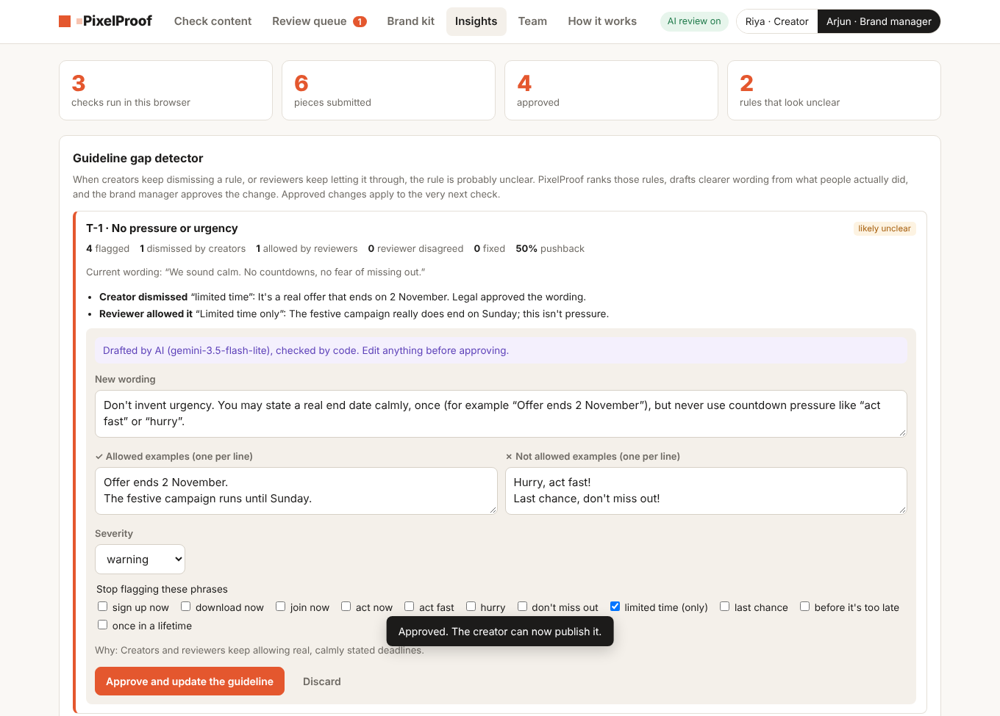
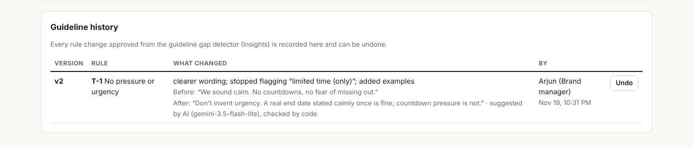
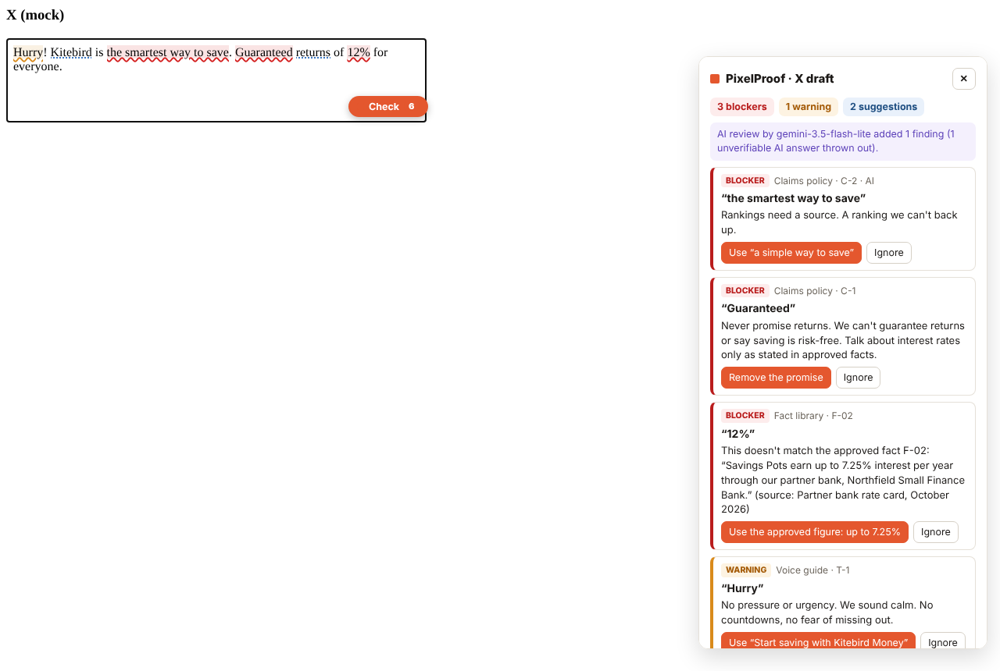
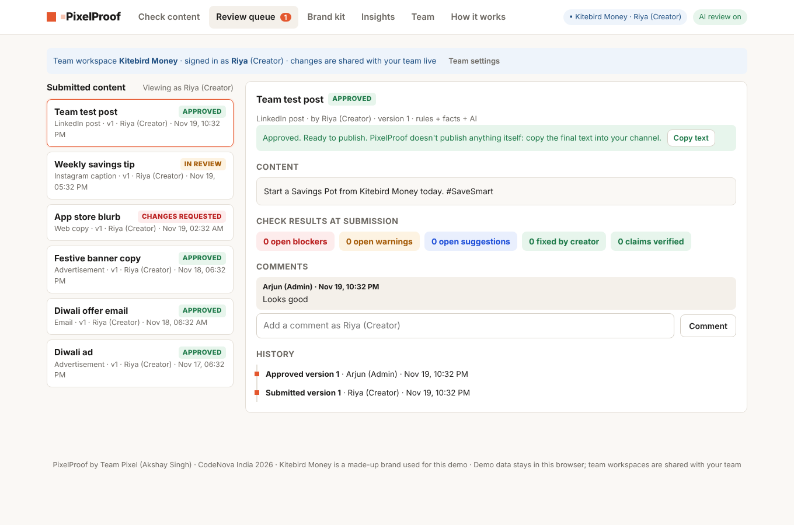
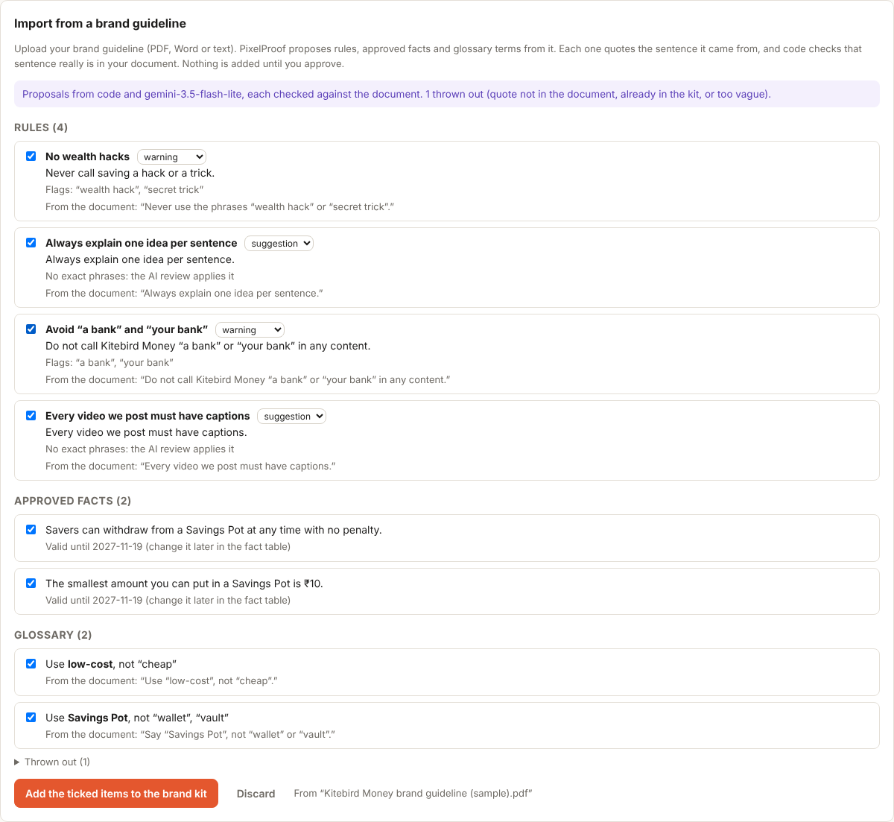
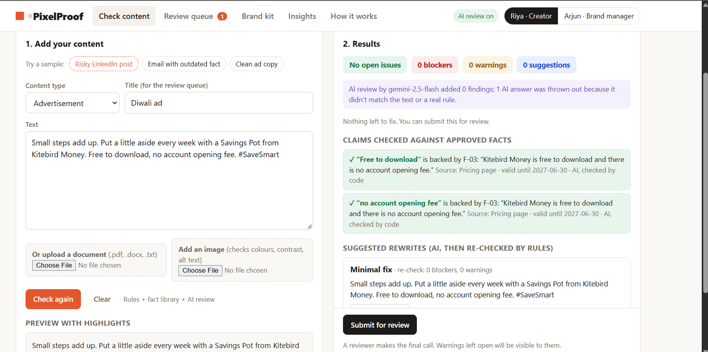

# PixelProof

**Brand checks before you publish.** Team Pixel (Akshay Singh) · CodeNova India 2026 · Inkloom AI brand-governance brief

### ▶ Live app: **https://pixelproof.vercel.app**
No sign-up needed for the demo. The Chrome extension and the shared team workspace are described below.

> **Every number is checked against approved facts by code. The AI can't pass a claim on its own.**

Paste a post, ad, email or web copy, upload a PDF or Word document, or add an image. PixelProof checks it against the brand's guidelines, approved facts, terminology and visual identity. Every issue comes back with the rule it breaks and a suggested fix, and a person makes the final approval.

The demo uses **Kitebird Money**, a made-up savings app with a ready-made brand kit, so you can try it straight away.

## Try it in two minutes
1. Click **Risky LinkedIn post**, then **Check against brand kit**.
2. Read each flag: what's wrong, why, and which rule or approved fact it comes from.
3. Apply the fixes (or dismiss one with a reason), then **Submit for review**.
4. Switch to **Arjun · Brand manager** (top right) and approve, or request changes.
5. Open **Insights**. The **guideline gap detector** shows that people keep pushing back on rule T-1 ("limited time"). Click **Suggest a clearer rule**, then **Approve**, then **See the next check change**. The phrase is no longer flagged, and the change is in **Brand kit → Guideline history**, where you can undo it.
6. Still as Arjun, open **Brand kit → Import from a brand guideline** and click **Try the sample guideline** (or upload your own PDF, Word or text file). Untick anything you don't want, click **Add the ticked items**, then **See it work**.
7. Open **Team** and click **Sign in as Arjun**. You get a fresh private copy of the demo workspace and a join code. In a private window, **Sign in as Riya** and join with the code. Submit as Riya and watch it arrive in Arjun's queue.

## Round 3: what's new
| Improvement promised in Round 2 | Done when… | Status |
| --- | --- | --- |
| **Guideline gap detector** (flagship) | a rule pushed back on several times is flagged, and an approved rewrite changes the next check | ✅ T-1 is flagged from real dismissals and overrides; approving the rewrite stops the next check flagging "Limited time only" (end-to-end test) |
| **Chrome extension** for LinkedIn, Gmail and X | it installs from the repository and checks a draft end to end on all three sites | ✅ Load unpacked from `extension/`; Check button, in-place highlights, in-place fixes, AI review, Send to review queue; side panel for any other page |
| **Shared team workspace** | a creator and a reviewer on different devices see the same queue | ✅ Supabase accounts, roles (creator, reviewer, admin) and a shared database with live updates; permissions enforced by the database. Checked live on a laptop and a phone |
| **Guideline import** (planned in Round 1, moved to future scope in Round 2, built in Round 3) | an uploaded guideline produces rules a manager approves | ✅ Upload a PDF, Word or text guideline; code and the AI propose rules, facts and glossary terms, each quoting a sentence code confirms is in the document; the manager ticks what to keep; the next check uses them; undo in the history |

Plus reliability and usability work: see [What was tightened](#what-was-tightened-in-round-3).

## Screenshots
| | |
| --- | --- |
|  |  |
| **Gap detector:** T-1 is "likely unclear"; AI drafts clearer wording with allowed and not-allowed examples | **Brand kit history:** every approved change, who made it, before/after, undo |
|  |  |
| **Extension:** an X draft checked in the compose box, issues underlined in place | **Team workspace:** the creator's device shows the reviewer's approval |
|  |  |
| **Guideline import:** every proposal shows the sentence it came from; the manager ticks what to keep | |
|  |  |
| Claims verified against fact F-03; one wrong AI answer thrown out by code | "12%" and "5 lakh" don't match the approved facts |

Screenshots of the extension are from the test pages described under [Testing](#testing).

## Features
**Checking**
- **Content in:** pasted text; PDF, Word and text files; images; drafts from LinkedIn, Gmail and X through the extension.
- **Rule checks:** promises of returns, pushy or get-rich language, competitor names, glossary terms, exclamation marks, link text, emojis, all caps, long sentences, hashtags, key messages.
- **Fact checks:** every number and ranking is matched against the approved fact library. Wrong figures, figures from expired facts and figures with no source are blockers, with the approved figure offered as the fix. Dates, times and things like "24/7" aren't treated as claims.
- **AI review (Google Gemini):** tone, voice and messaging, spelling and grammar, claims without numbers, and two rewrites.
- **The AI is checked by code** before anything is shown: the quoted words must be in the text, the rule must exist, and a "supported" claim must quote a real, unexpired fact. Rules that code checks exactly can't be raised by the AI. Rewrites are re-checked by the rules.
- **Visual identity:** main image colours compared with the brand palette, contrast of the main colours, required alt text.

**Workflow**
- **Human control:** fixes only on click; blockers must be fixed or dismissed with a reason before submitting; PixelProof never publishes.
- **Review:** creator and brand-manager roles, comments, approve, request changes, revise, agree or disagree with dismissals, "OK to publish", version history with word-by-word changes, activity timeline.
- **Brand kit editor:** voice, glossary, approved facts with sources and expiry dates, palette, rule on/off and severity, JSON import/export, guideline history with undo.
- **Guideline import:** upload a brand guideline (PDF, Word, text) or try the sample one ([docs/sample-brand-guideline.pdf](docs/sample-brand-guideline.pdf)). Code finds "use X, not Y" terms, banned quoted phrases, "always/never" rules and facts; the AI adds what code can't see. Every proposal must quote a sentence that code finds in the document, patterns that would flag ordinary writing are dropped, and anything already in the kit is skipped. The manager approves; it's one new kit version that can be undone.
- **Insights:** guideline gap detector, most common issues, issues by area, expired or expiring facts.

**Round 3**
- **Guideline gap detector:** counts, per rule, how often it was flagged, dismissed by creators, allowed by reviewers, disagreed with and fixed. Rules with repeated pushback are ranked "likely unclear". A suggested change is drafted by code from the evidence (which phrases were always allowed, whether to lower the severity), then improved by the AI with allowed and not-allowed examples. Code validates it (only real phrases can be removed, at least one phrase must stay). The brand manager edits and approves; the brand kit version goes up, the change is recorded with who, when, before and after, and the very next check uses it. Only signals after the latest change count, so a fixed rule drops off the list.
- **Chrome extension:** see [below](#chrome-extension).
- **Team workspace:** sign up or use the demo accounts; create a workspace (optionally with the sample brand kit and content) or join one with a 6-character code; admins change roles; the queue and brand kit update live on every device. A creator can't approve (the button isn't there, and the database refuses it if forced), and only brand managers can change the brand kit.

## Chrome extension
The extension adds a **Check** button to the compose box on **LinkedIn**, **Gmail** and **X**. It uses the same check engine and brand kit as the web app.

**Install from the repository**
1. Clone or download this repository (or download [`downloads/pixelproof-extension.zip`](downloads/pixelproof-extension.zip) and unzip it).
2. Open `chrome://extensions` in Chrome and turn on **Developer mode** (top right).
3. Click **Load unpacked** and choose the `extension` folder (or the unzipped `pixelproof-extension` folder).

**Use it**
- Start a LinkedIn post, a Gmail message or an X post, type, and click **▪ Check** at the bottom right of the box.
- Problems are underlined in your draft (red = blocker, amber = warning, blue = suggestion) and listed in a panel with the reason and the rule.
- Click a fix to change the words in place. Click **Ignore** to hide one. The list updates as you type.
- **Send to review queue** opens PixelProof with the draft already checked, ready to submit.
- On any other site, select text, right-click and choose **Check with PixelProof**. It opens in Chrome's side panel. Clicking the toolbar icon opens the side panel too.
- **Settings** (right-click the icon → Options): PixelProof address (default `https://pixelproof.vercel.app`), AI review on or off, and importing your own brand kit (export it from the web app's Brand kit page).

The AI review goes through the PixelProof server, so the Gemini key is never in the extension. Personal data is masked before sending.

## How it's built
| Part | Technology |
| --- | --- |
| Front end | Plain HTML, CSS and JavaScript (no build step) |
| Check engine | `js/engine.js`: rules, fact matching, checking the AI's answer, image analysis, diff, guideline gap detector. Runs in the browser, in the extension and in the tests. |
| AI | `api/check.js`: a Vercel serverless function calling the Google Gemini API (`gemini-3.5-flash-lite`, with `gemini-3.6-flash` as a backup; both can be changed with environment variables). Personal data is masked in the browser and again on the server. The key never reaches the browser. |
| Team workspace | Supabase (Postgres + accounts). `supabase/schema.sql` holds the tables, row level security, a trigger that stops creators approving, and sign-up/join functions. `js/team.js` talks to it; `api/config.js` gives the browser the public URL and key. |
| Extension | Chrome Manifest V3: content script for LinkedIn, Gmail and X, background worker for AI calls, side panel, options page |
| Hosting | Vercel, deployed from this repository |
| Storage | Browser `localStorage` in demo mode; Supabase in a team workspace |
| Documents | pdf.js and mammoth.js, loaded from cdnjs only when a file is uploaded |
| Tests | Node's built-in test runner (`npm test`, 35 tests), a database security test (SQL), and browser tests (see [Testing](#testing)) |

See **[CODE_GUIDE.md](CODE_GUIDE.md)** for a plain-English walkthrough of the code.

```
index.html, styles.css
js/brandkit.js       demo brand kit + samples
js/engine.js         check engine + guideline gap detector
js/team.js           team workspace (Supabase)
js/app.js            screens, review workflow, team mode
api/check.js         AI function (Vercel): content checks and rule rewrites
api/config.js        tells the browser where the team database is
supabase/schema.sql  database tables and security rules
extension/           Chrome extension (lib/ is a copy of the engine)
scripts/             build-extension.js
downloads/           packed extension
dev-server.js        local preview server
tests/               engine, API and extension tests; supabase/test/ has the security test
```

## Run it locally
You need [Node.js](https://nodejs.org) 18 or newer. There's nothing to install.
```
git clone https://github.com/Akshaysingh222/PIXELPROOF.git
cd PIXELPROOF
node dev-server.js          # then open http://localhost:3000
npm test                    # run the tests
```
- **AI review:** set `GEMINI_API_KEY` in your terminal first (for example `export GEMINI_API_KEY=...` or on Windows `set GEMINI_API_KEY=...`). Without it, the rule and fact checks still work.
- **Team workspace:** also set `SUPABASE_URL` and `SUPABASE_ANON_KEY` (see below). Without them, the Team tab explains that it isn't set up and everything else works.
- **Extension against your local copy:** in the extension's settings, set the address to `http://localhost:3000`.
- After changing `js/engine.js` or `js/brandkit.js`, run `npm run build:extension` so the extension gets the same code.

## Deploy your own
1. Fork or push this repository to GitHub.
2. In Vercel: **Add New → Project**, import it, Framework preset **Other**, deploy.
3. **Settings → Environment Variables:** add `GEMINI_API_KEY` (from Google AI Studio). Optional: `GEMINI_MODEL`, `GEMINI_FALLBACK_MODEL`, `AI_CHECKS_PER_MINUTE` (default 12 per visitor).
4. Redeploy.

### Team workspace (Supabase), optional
1. Create a free project at [supabase.com](https://supabase.com).
2. **SQL Editor → New query:** paste all of `supabase/schema.sql` and run it. It's safe to run again after an update.
3. **Authentication → Sign In / Providers → Email:** turn off **Confirm email** (otherwise new users must click an email link before signing in).
4. **Project Settings → API:** copy the **Project URL** and the **anon / publishable** key. Never use the `service_role` / secret key in this app.
5. In Vercel, add `SUPABASE_URL` and `SUPABASE_ANON_KEY`, then redeploy.
6. Demo accounts (optional): in **Authentication → Users → Add user**, create `arjun.manager@pixelproof-demo.com` and `riya.creator@pixelproof-demo.com` with password `PixelProof-Demo-2026` and **Auto Confirm** ticked. Each click on **Sign in as Arjun** creates a fresh private demo workspace with the sample content, so visitors never share (or break) one demo; Riya joins it with its code.

The anon key is public by design. Row level security in `schema.sql` decides who can read or change what: members only see their own workspace, creators can't approve or edit the brand kit, only admins change roles, and the last admin can't be removed.

## Testing
| What | How | Result |
| --- | --- | --- |
| Engine, API and extension | `npm test`: rules, fact matching, dates not treated as claims, checking the AI's answer, gap detector (ranking, suggestion, validation, applying, undo, only counting signals after a change), API validation (bad JSON, missing kit, empty text, CORS), guideline import (finding rules, facts and terms; throwing out made-up quotes and unsafe patterns; applying and undoing), API guide mode, extension manifest and engine copy | 35 / 35 pass |
| Database security | `supabase/test/rls_test.sql` on Postgres 16 with a small stand-in for Supabase auth: creator can't approve (also through an upsert), can't edit the kit, can't change roles; last admin protected; outsiders and signed-out visitors see nothing; wrong join codes rejected | all pass |
| Web app, end to end | Playwright in Chrome against the real app and API with a stand-in for Gemini, and a stand-in for the Supabase API that runs every query on the real `schema.sql`: the full creator → reviewer → revise → approve journey; the gap detector changing the next check, history and undo; guideline import from the sample and from an uploaded file (a made-up AI quote thrown out, the next check using the imported rules, undo); empty input, double clicks, refresh mid-check, extension hand-off, bad imports, mobile width; two browsers sharing one team workspace (each demo visitor getting their own workspace, sign up and create by hand, join by code, live queue updates, approval seen on the other device, database refusing a forced approval, role change, refresh, a draft from the extension, sign out) | 56 / 56 pass |
| Extension | Playwright loads the real extension into Chrome and uses pages with the same compose-box markup as LinkedIn (Quill editor), Gmail (message body) and X (Draft.js): button appears, issues listed and underlined, AI review, fix applied in the box (also while the AI is still running), ignore, Send to review queue; harder layouts (box already focused when the page loads, a post window opened as a modal dialog like LinkedIn's, editor inside shadow DOM, editor inside a frame); no button while the box is empty; side panel with selected text; options | 45 / 45 pass |
| Real sites | By hand on 19 Nov 2026 with my own accounts: extension loaded unpacked from the repository; a draft checked on linkedin.com, mail.google.com and x.com, AI review finished, Send to review queue opened the draft in PixelProof. Team workspace checked live with a laptop (Arjun) and a phone (Riya) | works |

### User test
On 20 November 2026, three people who had never seen PixelProof tried it on the live site. The task: *"You write posts for a savings app called Kitebird Money. Check a risky post, fix it until you're allowed to submit it, then approve it as the brand manager."* I gave no help, and noted whether they finished, how long it took and what confused them.

| Tester | Finished | Time | What happened | What I changed |
| --- | --- | --- | --- | --- |
| Amartya Thakur | Yes | ~5 min | Understood each flag and the fixes straight away; found the checking useful | Nothing needed |
| Nishant Sharma | Yes | ~9 min | Went beyond the task: switched between creator and brand manager and tried several other features; found it smooth | Nothing needed |
| Abhishek Sharma | Yes | ~16 min | At first didn't understand what PixelProof was for; it clicked when he saw it works inside Gmail, X and LinkedIn | The first screen now says in plain words what PixelProof does and why, and links to the extension |

All three are students, not brand professionals, so this checks that a stranger can get through the main journey alone, not how a real brand team would use it. Testing with a real brand team is month 1 of the roadmap.

Limits of the tests: the AI is replaced by a stand-in that gives fixed answers, so they test how PixelProof handles AI answers (including wrong ones), not the quality of Gemini's answers. LinkedIn, Gmail and X change their pages often; if the Check button stops appearing on one of them, the side panel still works with selected text.

## What was tightened in Round 3
- **Double actions:** Check and Submit are disabled while a check runs; approve, request changes, revise and override only work on items in the right state; a second click does nothing.
- **Refresh:** drafts survive a reload; an AI review interrupted by a reload shows "interrupted" with a retry instead of spinning forever; a team workspace reopens after a reload.
- **Bad input:** empty text, unreadable or password-protected PDFs, old .doc files, huge files, non-image uploads, brand kit files with missing parts or broken patterns, facts with past expiry dates, wrong passwords, wrong join codes. Each gets a plain message.
- **Empty states:** empty queue, no gaps, no facts, no glossary, no workspaces, team not set up.
- **Long text:** the AI reads the first 6,000 characters (shown under the text box); rules and facts check all of it.
- **Storage:** a warning if the browser won't save (private mode or full storage).
- **Usability:** quick-start steps on the first screen, Ctrl+Enter to check, reviewer feedback shown while revising, "See the next check change" after approving a rule change, confirmations before resetting or deleting, live updates that don't wipe what you're typing.
- **API:** clear 400 errors for bad requests, CORS for the extension, a per-visitor limit that can be configured.

## Changes from the Round 2 plan
- **Gap suggestions start with code, then the AI improves them.** The rule change is useful even when the AI is off or busy, and the AI's suggestion is validated by code like every other AI answer.
- **Extension highlights use the browser's Custom Highlight API** instead of wrapping words in new elements, so LinkedIn, Gmail and X editors aren't disturbed. Fixes are typed in with the browser's insert-text command so the sites register them.
- **The extension sends drafts to the review queue through the web app** (it opens PixelProof with the draft) instead of writing to the database itself, so there is one place where content is submitted and one set of permissions.

## Roadmap
Each phase is aimed at a specific group of people and has one number that says whether it worked.

| Phase | For | What gets built | How we'll know it worked |
| --- | --- | --- | --- |
| **Month 1: pilot** | One real brand team (5–10 people: 1 brand manager, creators, 1 compliance reviewer) | Extension signs in to the team workspace and uses its brand kit; Chrome Web Store listing (no Developer mode); fact expiry reminders by email; guideline import for Word headings and tables; fixes from the first user tests | At least 70% of the team's posts are checked before publishing; time from submit to approval drops by a third |
| **Month 3: daily use** | Growing companies in finance, health and education, where a wrong claim is costly | Per-channel rules (e.g. hashtags fine on X, not in email); Google Docs and Notion checks; approvals in Slack; audit export (who approved what, against which brand kit version); several brands in one account for agencies | Off-brand or unsupported claims found after publishing fall below 1 in 50 posts; gap detector rewrites approved at least once a month per team |
| **Month 6: scale** | Agencies and larger marketing teams | Fact search by meaning for big fact libraries; logo and layout checks in images; ready-made rule packs for regulated sectors; option to run the AI on the company's own model | 10 paying teams; under 5% of flags dismissed as wrong (the gap detector keeps rules clear) |

**Risks we'll watch:** sites changing their compose boxes (the side panel is the fallback, and each site gets a test page); AI cost per check (rules and facts run first, free, and the AI reads only what's needed); trust (every AI answer stays verified by code, and every change can be undone).

## Responsible design
- PixelProof can be wrong. It never edits or publishes without a person's click, in the web app or the extension.
- AI findings are labelled "AI check"; rule and fact findings are labelled separately. AI-suggested rule changes say who drafted them and need a brand manager's approval.
- Emails, phone numbers, PAN and ID-style numbers are masked before text is sent to the AI.
- The deployment uses a paid Gemini API key; paid-tier inputs aren't used to improve Google's products.
- Demo mode keeps data in the user's browser. Team workspaces keep the brand kit and queue in Supabase, protected by row level security.
- The demo team accounts can be used by anyone trying the app, so each visitor gets their own demo workspace; still, don't put real content in them.

## How it was built
I'm a one-person team. I decided the idea, the scope and how each part should behave, set up GitHub, Vercel, Supabase and the Gemini API, and tested the app, reporting each problem I found. An AI assistant (Claude) wrote most of the code, the tests and these docs under my direction. Problems found and fixed in Round 3:

- Dates and times like "2 November" or "24/7" were treated as unsupported number claims → dates, times and years are skipped by the fact checker.
- Saving a comment on an approved item as a creator was refused by the database, because an "upsert" first runs as an insert → the approval guard now compares with the stored row.
- The team sign-in forms lost what you typed while saving → forms are read before the screen redraws, and inputs are put back after an error.
- A screen redraw could keep asking for the workspace list in a loop → fixed, and covered by the browser test.
- Sending a second draft from the extension while PixelProof was already open didn't load it → the app now also listens for the link changing.
- On the real LinkedIn, the Check button didn't appear: the post window is a pop-up dialog drawn above the page, and its box already had focus when the extension loaded → the button goes inside the pop-up, and the box is also found from typing, clicks and pastes.
- On the real X, the button covered the last words → it now sits below small boxes and only appears once there's text.
- "Send to review queue" landed on the Review queue when signed in to a team → the incoming draft is kept until the workspace has loaded.

Problems fixed in Round 2 are in the git history.

## Disclosure
AI assistance (Claude by Anthropic) was used to plan, write and test the code and documentation, as described above. Google Gemini was used for research and finding sources. The running product uses the Google Gemini API for the AI review and rule suggestions, and Supabase for the team workspace. pdf.js (Apache 2.0), mammoth.js (BSD-2-Clause) and supabase-js (MIT) are loaded from public CDNs. No templates or code from before the build window were used. Kitebird Money, its partner bank and all demo content are fictional.
