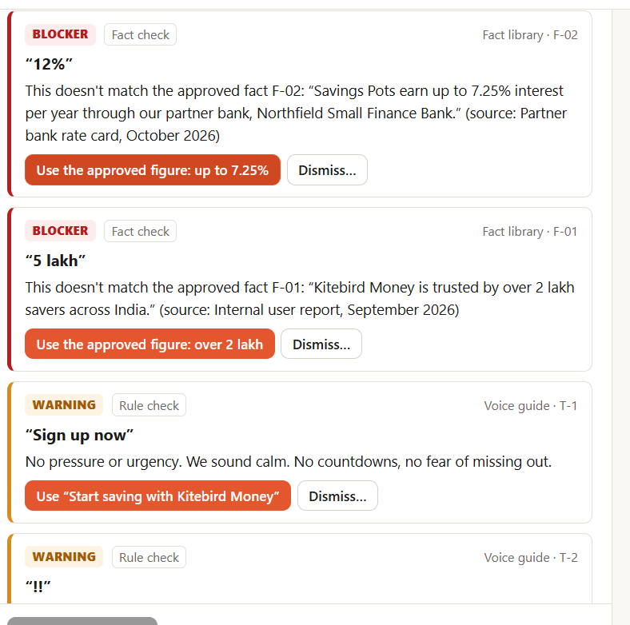
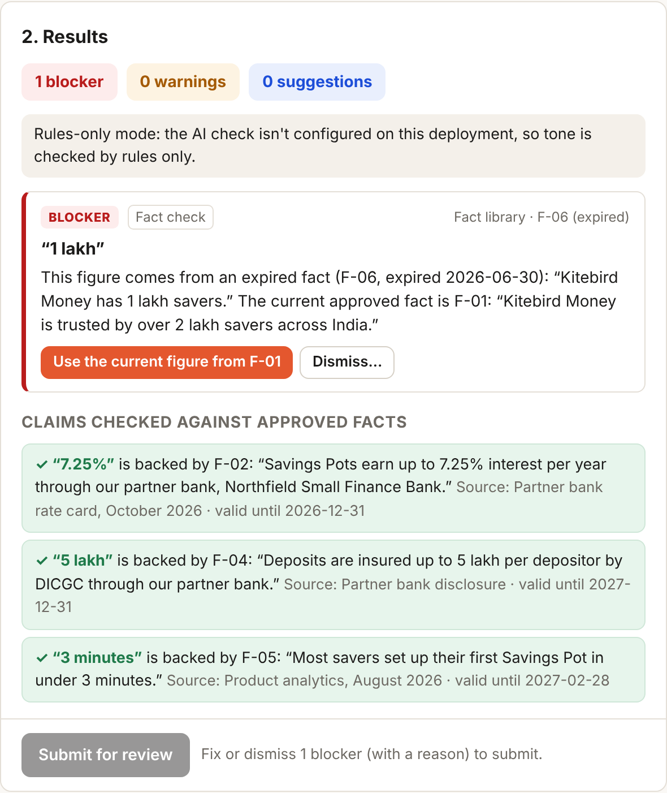
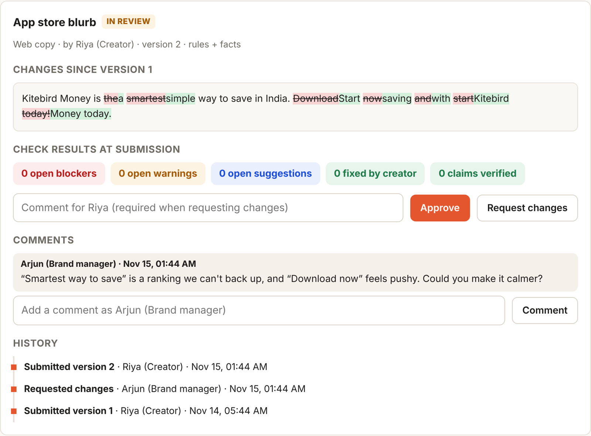
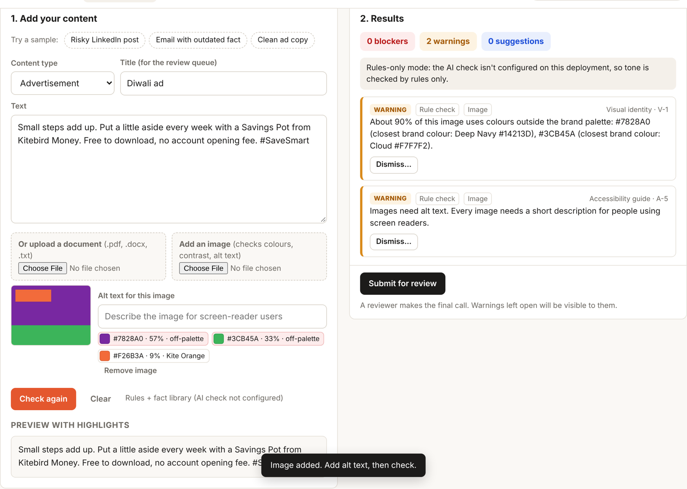
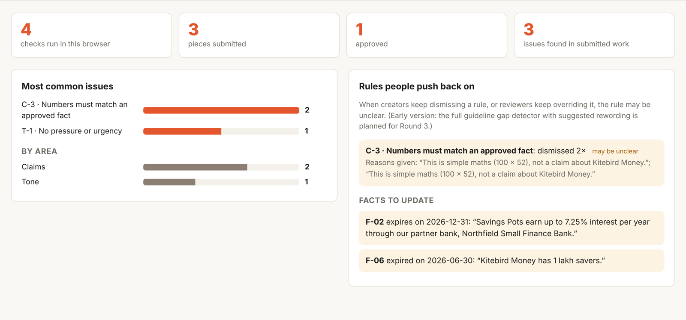

# PixelProof

**Brand checks before you publish.** Team Pixel (Akshay Singh) · CodeNova India 2026 · Inkloom AI brand-governance brief

### ▶ Live app: **https://pixelproof.vercel.app**
No sign-up, nothing to install.

> **Every number is checked against approved facts by code. The AI can't pass a claim on its own.**

Paste a post, ad, email or web copy, upload a PDF or Word document, or add an image. PixelProof checks it against the brand's guidelines, approved facts, terminology and visual identity. Every issue comes back with the rule it breaks and a suggested fix, and a person makes the final approval.

The demo uses **Kitebird Money**, a made-up savings app with a ready-made brand kit, so you can try it straight away.

## Try it in one minute
1. Click **Risky LinkedIn post**, then **Check against brand kit**.
2. Read each flag: what's wrong, why, and which rule or approved fact it comes from.
3. Apply the fixes (or dismiss one with a reason), then **Submit for review**.
4. Switch to **Arjun · Brand manager** (top right) and approve, or request changes.
5. Open **Insights** to see repeat issues and the rules people push back on.

## Screenshots
| | |
| --- | --- |
|  |  |
| **Live:** claims verified against fact F-03; one wrong AI answer thrown out by code | **Live:** "12%" and "5 lakh" don't match the approved facts |
|  |  |
| A figure from an expired fact is blocked; the rest are verified | Reviewer view: what changed, results at submission, history |
|  |  |
| Image check: off-palette colours and missing alt text | Insights: common issues and rules people push back on |

The last four were taken from the same build running locally without an AI key (rules-only mode).

## What works
- **Content in:** pasted text; PDF, Word and text files; images.
- **Rule checks:** promises of returns, pushy or get-rich language, competitor names, glossary terms, exclamation marks, link text, emojis, all caps, long sentences, hashtags, key messages.
- **Fact checks:** every number and ranking is matched against the approved fact library. Wrong figures, figures from expired facts and figures with no source are blockers, with the approved figure offered as the fix.
- **AI review (Google Gemini):** tone, voice and messaging, claims without numbers, and two rewrites.
- **The AI is checked by code** before anything is shown: the quoted words must be in the text, the rule must exist, and a "supported" claim must quote a real, unexpired fact. Rules that code checks exactly can't be raised by the AI. Rewrites are re-checked by the rules.
- **Visual identity:** main image colours compared with the brand palette, contrast of the main colours, required alt text.
- **Human control:** fixes only on click; blockers must be fixed or dismissed with a reason before submitting; PixelProof never publishes.
- **Review workflow:** creator and brand-manager roles, comments, approve, request changes, revise, agree or disagree with dismissals, "OK to publish", version history with word-by-word changes, activity timeline.
- **Brand kit editor:** voice, glossary, approved facts with sources and expiry dates, palette, rule on/off and severity, JSON import/export.
- **Insights:** most common issues, issues by area, rules people push back on, expired or expiring facts.
- **Reliability:** rule and fact checks work without AI; a backup AI model when the main one is slow; a retry button; 15 automated tests.

## How it's built
| Part | Technology |
| --- | --- |
| Front end | Plain HTML, CSS and JavaScript (no build step) |
| Check engine | `js/engine.js`: rules, fact matching, checking the AI's answer, image analysis, diff. Runs in the browser and in the tests. |
| AI | `api/check.js`: a Vercel serverless function calling the Google Gemini API (`gemini-2.5-flash`, with `gemini-2.5-flash-lite` as a backup). Personal data is masked in the browser and again on the server. The key never reaches the browser. |
| Hosting | Vercel, deployed from this repository |
| Storage | Browser `localStorage` for the demo |
| Documents | pdf.js and mammoth.js, loaded from cdnjs only when a file is uploaded |
| Tests | Node's built-in test runner (`npm test`, 15 tests) |

See **[CODE_GUIDE.md](CODE_GUIDE.md)** for a plain-English walkthrough of the code.

```
index.html, styles.css
js/brandkit.js   demo brand kit + samples
js/engine.js     check engine
js/app.js        screens and review workflow
api/check.js     AI function (Vercel)
dev-server.js    local preview server
tests/           engine tests
docs/            screenshots
```

## Run it locally
```
node dev-server.js          # then open http://localhost:3000
npm test                    # run the engine tests
```
Set `GEMINI_API_KEY` in your terminal first if you want the AI review locally. Without it, the rule and fact checks still work.

## Deploy your own
1. Fork or push this repository to GitHub.
2. In Vercel: **Add New → Project**, import it, Framework preset **Other**, deploy.
3. **Settings → Environment Variables:** add `GEMINI_API_KEY` (from Google AI Studio), then redeploy.

## How it was built
I'm a one-person team. I decided the idea, the scope and how each part should behave, set up GitHub, Vercel and the Gemini API, and tested the live app, reporting each problem I found. An AI assistant (Claude) wrote most of the code, the tests and these docs under my direction. Problems found and fixed during the build:

- Gemini's reply sometimes wasn't valid JSON → it now has to follow a fixed answer schema, and small mistakes are repaired.
- Replies were cut off because the model's hidden "thinking" used up the output space → thinking is switched off for this task, and early stops are retried.
- The AI was slow at a busy time → a faster backup model, a 60-second limit and a retry button.
- The AI flagged "#SaveSmart" as wrong when it was correct → rules that code checks exactly can no longer be raised by the AI.
- "7.25%" was read as "7" and "25%", and "₹100 a week" wasn't read as a number → the number reader was fixed.

## Changes from the Round 1 plan
- **Web app first, Chrome extension later:** judges and new users need to open a link and use it with no installation.
- **Browser storage instead of Supabase** for Round 2, so the demo works instantly without sign-up.
- **Keyword matching instead of vector search** for facts: with a small fact library it's faster and easy to explain.
- **Images and documents moved into Round 2,** because visual identity and documents are part of the brief.

## Round 3 plan
**Flagship: Guideline gap detector.** Turn dismissals, overrides and reviewer disagreements into a ranked list of rules that seem unclear. For each one, the AI drafts clearer wording with an allowed and a not-allowed example, and the brand manager approves it. Approved changes update the brand kit, with a version history.

**Also:**
- **Chrome extension for LinkedIn, Gmail and X:** check a draft inside the compose box on all three sites, with issues highlighted in place, reusing the same engine and review queue. A side panel works with any selected text as a fallback if a site changes its page.
- **Shared team workspace:** real accounts and a shared database, so a creator and a reviewer on different devices see the same queue.

**Moved to future scope:** importing rules from a brand guideline PDF.

## Responsible design
- PixelProof can be wrong. It never edits or publishes without a person's click.
- AI findings are labelled "AI check"; rule and fact findings are labelled separately.
- Emails, phone numbers, PAN and ID-style numbers are masked before text is sent to the AI.
- The deployment uses a paid Gemini API key; paid-tier inputs aren't used to improve Google's products.
- Demo data stays in the user's browser.

## Disclosure
AI assistance (Claude by Anthropic) was used to plan, write and test the code and documentation, as described above. The running product uses the Google Gemini API for the AI review step. pdf.js (Apache 2.0) and mammoth.js (BSD-2-Clause) are loaded from cdnjs to read documents. No templates or code from before the build window were used. Kitebird Money, its partner bank and all demo content are fictional.
